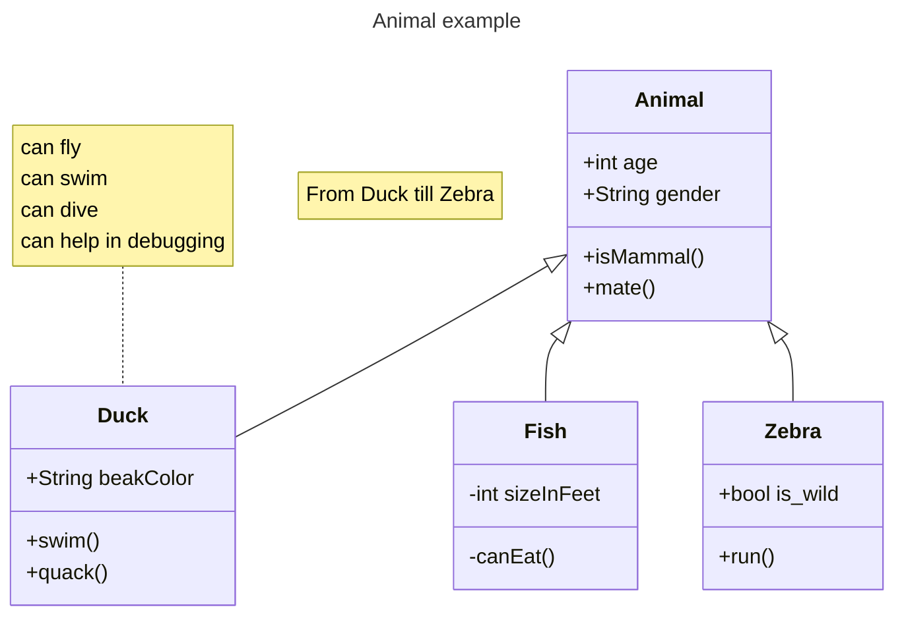

## DOCUMENTACAO DO PROJETO
integrantes do projeto:
JUAN MONTEAGUDO ALMEIDA 2ºSEM

RAFAEL GUSTAVO DOMINGUES FERREIRA 2ºSEM

ARTHUR SALES RIBEIRO 2ºSEM

GUILHERME BRAGA LIMA 2ºSEM

PEDRO HENRIQUE GARIPUNA GARCIA 2ºSEM 

git status - verifica os status dos arquivos

git add . - adicionado todos os arquivos em stage de envio 

git commit -m "comentario" adiciona um comentario para seu projeto 

git push - envia as aleterações para seu github 

git pull - recebe as alteracoes do github

